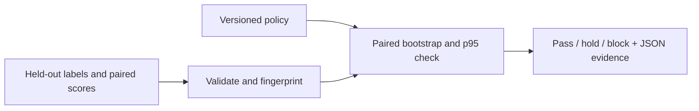

# Model Rollout Gate

An offline release gate for binary probability models. It compares champion and challenger scores on the same labeled examples and writes a replayable JSON decision. Use it as a CI check before a human makes the rollout decision. It never deploys a model or sends data anywhere.



## Run the end-to-end example

With [uv](https://docs.astral.sh/uv/) and Python 3.11+, run from the repository root:

```bash
uv sync --locked
OMP_NUM_THREADS=1 uv run --locked python examples/make_demo.py demo-output/predictions.jsonl
uv run --locked rollout-gate demo-output/predictions.jsonl --policy examples/policy.json
```

The demo trains logistic regression and histogram gradient boosting on 2,000 synthetic examples, then scores a separate 500-example set. On the reference run, Brier loss improved from 0.227 to 0.160 and the gate passed. To demonstrate a blocked release, generate a different file with `--regress`; it inverts challenger probabilities in the `priority` segment. Timing values are synthetic, not benchmark measurements. The generator and `--out` refuse to replace existing files; choose a new path on subsequent runs.

## Data and policy

Each JSONL row represents one independent evaluation unit. The two models must use exactly the same sample and label:

```json
{"sample_id":"request-1","segment":"priority","label":1,"champion":0.62,"challenger":0.89,"champion_ms":14.0,"challenger_ms":16.0}
```

The policy specifies the minimum global and per-segment counts, required segments, absolute Brier degradation margins, maximum ratio of p95 latencies, and bootstrap draws and seed. See `examples/policy.json` for selecting required segments; omitted settings use the defaults in `rollout_gate/evaluation.py`. Optional segments are reported but cannot block a decision. Both labels must appear in a group for it to be evaluated.

For each eligible group, the gate bootstraps the mean paired Brier difference `champion loss − challenger loss`. It compares the lower endpoint of the central 95% percentile interval against the negative tolerance. This is a conservative release rule, not a formal proof of equivalence. The JSON report includes scores, intervals, sample counts, the effective policy, and a SHA-256 digest of the exact input bytes. The report does not include row-level predictions or IDs.

| Exit code | Decision | Meaning |
| --- | --- | --- |
| 0 | pass | All configured checks passed |
| 1 | input/output error | No decision; fix invalid data or paths |
| 2 | block | At least one quality or latency gate failed |
| 3 | hold | No failing gate, but required evidence is missing |

## Limits and operations

- Use fresh holdout data, paired by sample, with predeclared slices. Repeated users or temporal dependence need clustered or time-aware resampling; row bootstrap does not address them. Intervals are not adjusted for multiple comparisons. The latency check is an empirical p95 ratio without an uncertainty interval.
- Sample IDs must be unique; there is one segment per sample. The CLI is designed for local files with at most 10,000 rows, not streaming production requests.
- Keep holdout data private and use comparable latency collection conditions. A pass is evidence for review, not permission for automatic deployment or a substitute for production monitoring.

Run `uv run --locked pytest -q` to check validation, verdicts, segment regressions, and JSON reports. The CI matrix also runs both end-to-end scenarios.
